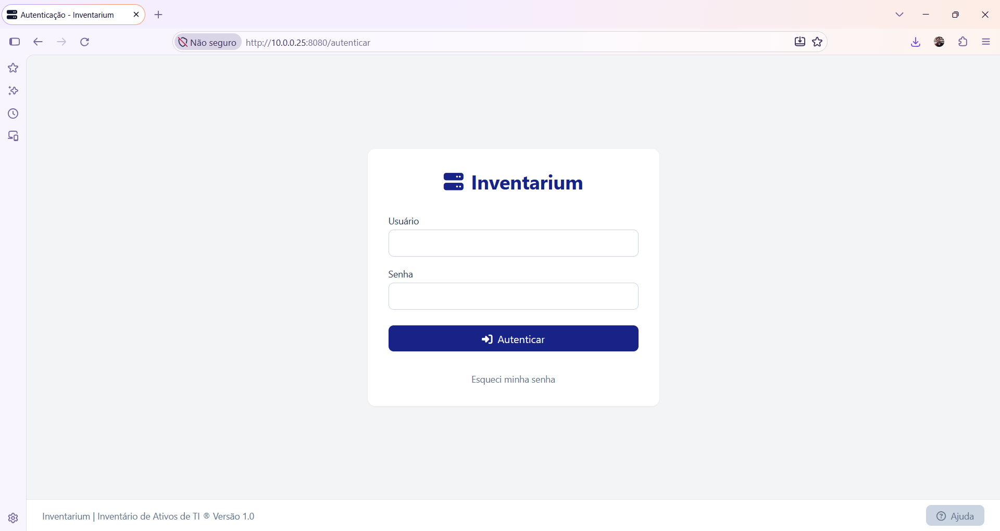
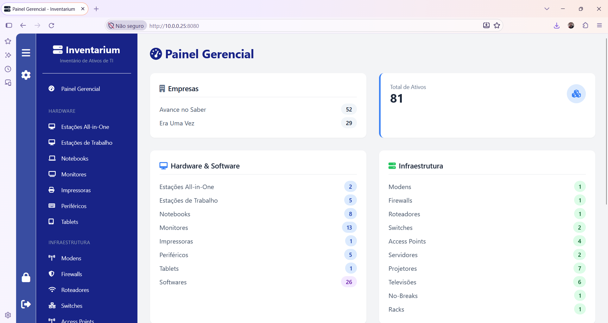
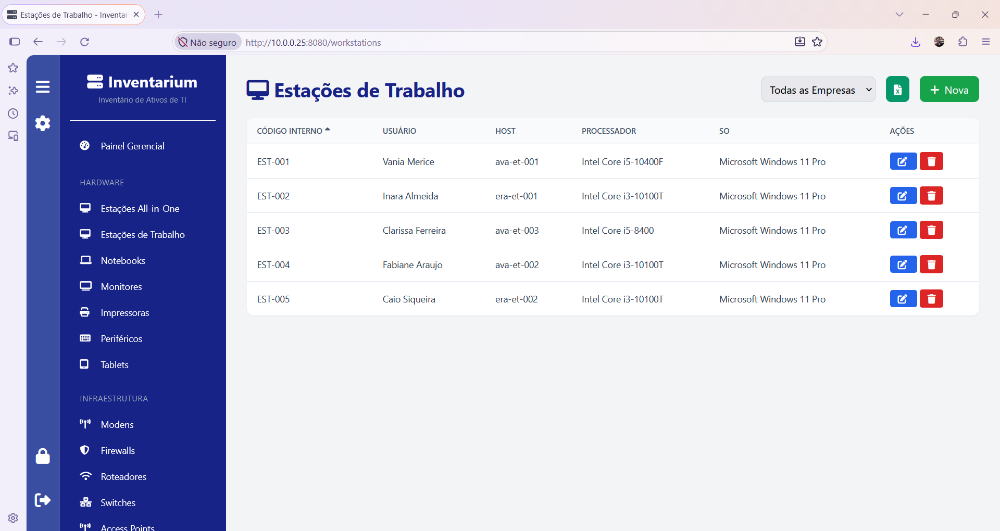
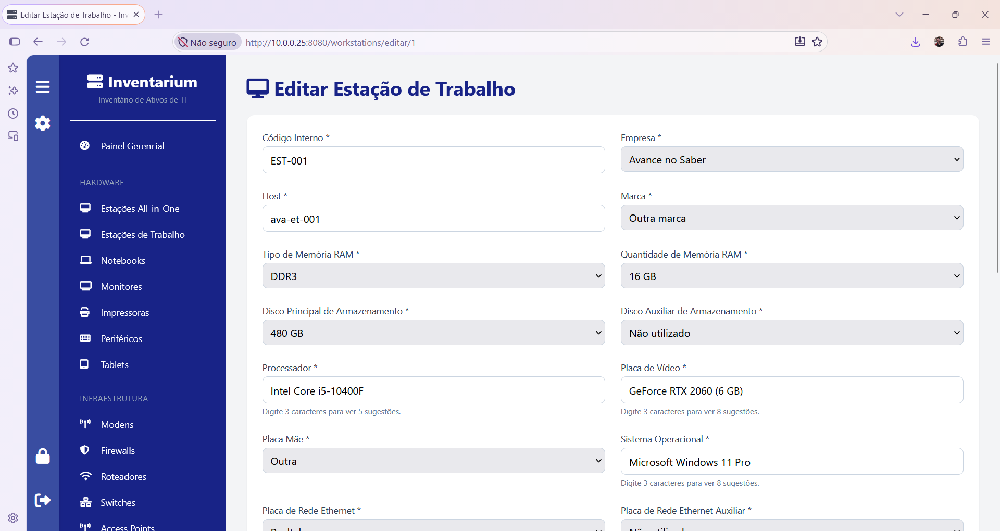
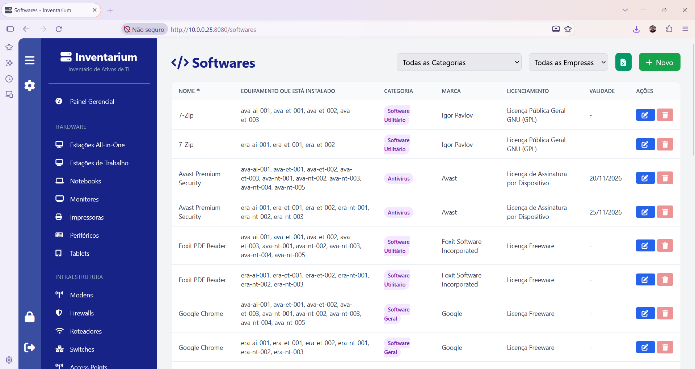
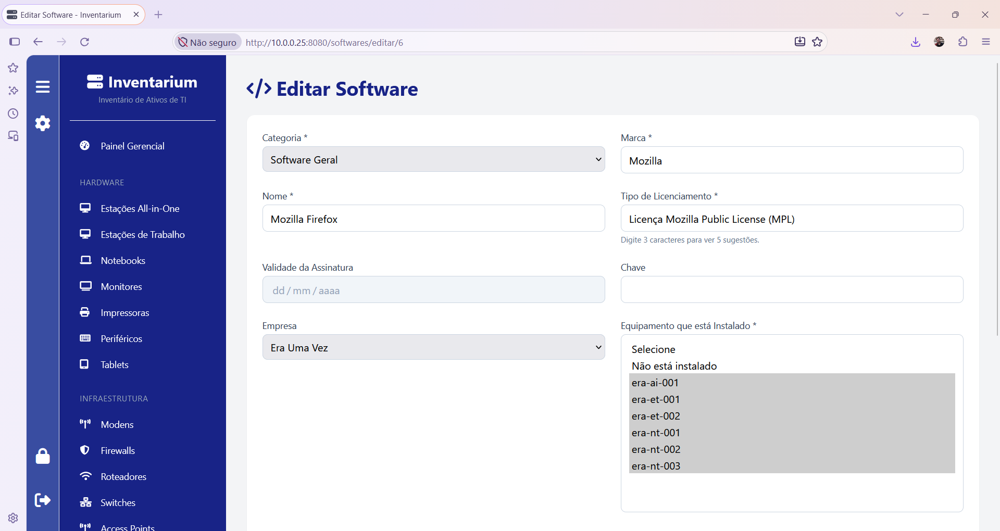

 [](CODE_OF_CONDUCT.md)

# Inventarium | Inventário de Ativos de TI

## Sobre o Inventarium

O **Inventarium** é uma solução voltada para a criação de um **Inventário de Ativos de TI** em uma organização.

Nessa solução, o usuário cadastra quais são as Empresas que possuirão o inventário, junto com as áreas e os locais em que esses equipamentos são utilizados, e na sequência os usuários deles. Depois, temos as seguintes opções para armazenar as informações:
- Hardware: Estações All-in-One, Estações de Trabalho, Notebooks, Monitores, Impressoras, Periféricos, Tablets;
- Infraestrutura: Modens, Firewalls, Roteadores, Switches, Access Points, Servidores, Projetores, Televisões, No-Breaks, Racks;
- Softwares;
- Empresa: Empresas, Áreas e Locais, Usuários;
- Gestão: Administradores, Chaves de Acesso, Webservices, Configurações.

Nas áreas de Hardware, Infraestrutura e Softwares, o usuário pode gerar um relatório com as informações no formato do Excel.

Para realizar o cadastro dos ativos, precisamos de informações adicionais, como marcas de discos, memória RAM, processadores, dentre outras. Para isso, temos os seguintes cadastros auxiliares:
- Configurações: Discos - Tamanhos, Marcas de Hacks, Marcas de Impressoras, Memórias RAM - Quantidade, Memórias RAM - Tipos, Marcas de No-Breaks, Marcas de Periféricos, Tipos de Periféricos, Marcas de Placas-mãe de Desktops, Marcas de Placas-mãe de Notebooks, Marcas de Placas-mãe de Servidores, Marcas de Placas de Redes, Modelos de Placas de Vídeo, Modelos de Processadores de Desktops, Modelos de Processadores de Notebooks, Modelos de Processadores de Servidores, Marcas de Servidores, Sistemas Operacionais - Desktops, Sistemas Operacionais - Servidores, Tipos de Licenças de Softwares, Marcas de Tablets, Monitores - Tamanhos, Marcas de Televisões.

Em telas de cadastro onde são utilizados endereços, como na áreas de Empresas e Usuários, o **Inventarium** utiliza a **API ViaCEP**, que é um webservice para a consulta de CEPs gratuito. Com a utilização dessa API, após o usuário final digitar um CEP, como por exemplo '01310-000', o sistema busca as informações na API, e depois, preenche no formulário automaticamente 'Avenida Paulista' no Logradouro, 'Bela Vista' no Bairro, 'São Paulo' na Cidade e 'São Paulo (SP)' no Estado.

Visando o apoio na gestão das informações auxiliares, existem 3 webservices REST, acessados com autenticação Bearer Token, que podem ser utilizados:
- GET /resumo: Retorna o resumo dos ativos cadastrados;
- GET /ativos: Retorna todos os ativos cadastrados;
- GET /informacoes: Retorna as informações utilizadas nos cadastros dos ativos, como inf_disco_tamanho, inf_hacks, inf_impressoras, inf_memorias_ram_qtde, inf_memorias_ram_tipo, inf_nobreaks, inf_perifericos, inf_perifericos_computador, inf_placa_mae_desktop, inf_placa_mae_notebook, inf_placa_mae_servidor, inf_placa_rede, inf_placas_de_video, inf_processadores_desktop, inf_processadores_notebook, inf_processadores_servidor, inf_servidores, inf_so_desktop, inf_so_servidores, inf_sofwares_licencas, inf_tablets_marcas, inf_tamanho_monitor, inf_televisao_marca;
- POST /informacoes: Criar um novo registro possuindo uma informação que será utilizada no cadastro de ativos;
- PUT /informacoes: Alterar um registro de uma informação que é utilizado no cadastro de ativos.

Com a finalidade de avisar os administradores do **Inventarium**, quando os softwares licenciados através de assinaturas estão próximos do encerramento da validade desses licenciamentos, existe o script **verificar_validade_softwares.py** que está no diretório **scripts**. Ao ser executado através de uma tarefa agendada no sistema operacional, ele verifica quais softwares estão próximos do vencimento e envia um e-mail aos administradores com essa informação.

## Tecnlogias Utilizadas

- Python (>=3.13)
- Flask (>=3.1.0)
- Flask-SQLAlchemy (>=3.1.1)
- openpyxl (>=3.1.5)
- SQLite (>=3.5)
- ViaCEP - Webservice para a consulta de CEPs gratuito

## Como Instalar em um Servidor Debian

Para instalar em um servidor Debian 13, você irá utilizar o Python, PIP, Flask, Flask-SQLAlchemy, openpyxl e o Gunicorn.

Nesse material [INSTALAR.md](INSTALAR.md) ensino esse procesdimento.

Caso queira colocar ele em um servidor público na internet, nas portas HTTP (80) e HTTPS (443), recomendo a utilização do Nginx com um proxy reverso junto com o Gunicorn, gerando as chaves SSL com o Let's Encript.

## Perguntas Frequentes (FAQ)

### Quem pode utilizar esse software?

Qualquer pessoa pode utilizar, basta possuir uma estação de trabalho com o um servidor com Python, PIP, Flask, Flask-SQLAlchemy e o openpyxl.

### Quem pode contribuir?

Qualquer desenvolvedor pode contribuir, sendo muito bem-vindo! Caso queira contribuir, veja nosso [Código de Conduta | Contributor Covenant Code of Conduct](CODE_OF_CONDUCT.md).

### Qual a senha inicial do Inventarium?

```
Usuário: administrador
Senha: Inv3nt@r!um9
```

## Autor

[Diego Mendes Rodrigues](https://www.linkedin.com/in/diegomendesrodrigues/)

## Licença

A licença do **Inventarium | Inventário de Ativos** de TI é a [GNU General Public License (GNU GPL)](GLP-3.0.md).

## Telas do Inventarium

Página de Autenticação




Painel Gerencial com Indicadores




Listagem com as Estações de Trabalho




Cadastro de uma Estação de Trabalho




Listagem com os Softwares Cadastrados




Cadastro de um Software


